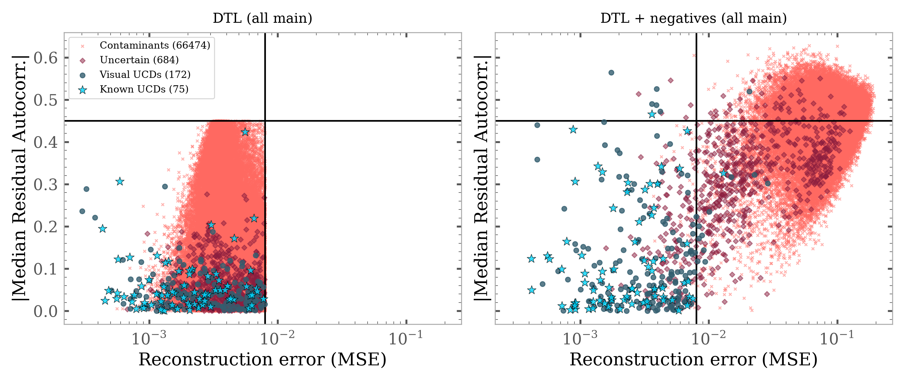
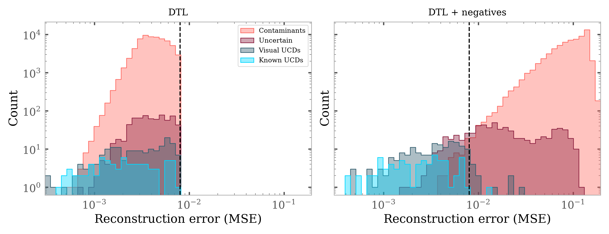

# Agent-assisted active learning against contaminants in Euclid UCD spectra

*Pedro Mas Buitrago (Centro de Astrobiología, CSIC-INTA)*

This repository records one piece of an ongoing search for ultracool dwarfs (UCDs) in Euclid NISP spectra:
how a human-in-the-loop labelling process, run together with an AI coding agent (Claude Code), turned a
contaminated candidate list into a labelled training set, and how that set was used to change the
transfer-learning step itself. It contains the list of methodological
decisions ([`docs/decisions.md`](docs/decisions.md)) and an edited log of the work with the agent
([`agent_log.md`](agent_log.md)).

## The problem

We look for UCDs in Euclid Q1 red-grism spectra with a dense autoencoder (AE) pre-trained on Sonora Elf Owl
synthetic spectra and adapted to real spectra by deep transfer learning (DTL) on known UCDs. A spectrum is a
candidate when the AE reconstructs it well: low reconstruction error overall, and no
structure in the residuals.

The starting point of this repository is the two candidate samples selected by that original AE with the
thresholds of each: **gold** (MSE ≤ 0.0045, residual autocorrelation ≤ 0.2) and **main** (MSE ≤ 0.008,
autocorrelation ≤ 0.45; gold ⊂ main).

The catch: **an AE trained only on UCDs learns to reconstruct anything smooth and red enough.** Galaxies with
broad emission lines on a red continuum pass every cut, and on visual inspection most candidates turned out
to be contaminants.

## The loop

```
 visual labels ──► classifier (P(contaminant)) ──► agent analyses labels & CV errors ──► next batch to inspect
      ▲                                                     │
      └───────────────── human labels the batch ◄───────────┘
                         (repeat until every candidate is labelled)
                                         │
                                         ▼
     DTL fine-tuning with labelled contaminants as negative examples ──► re-predict candidates
```

1. **Label.** I inspect spectra in an interactive widget (including spectrum, AE reconstruction, nearest known UCDs) and
   label them `ucd`, `contaminant` or `uncertain`.
2. **Analyse.** A gradient-boosting classifier is retrained on the labels. The agent reads the labels and the
   classifier's cross-validated errors and reports where it fails.
3. **Choose the next batch.** Fixed random samples of each predicted class (unbiased purity), then every
   predicted UCD, borderline and out-of-range objects. Objects with P(contaminant) > 0.3 are labelled in bulk;
   everything below is inspected by eye.
4. **Change the DTL.** With the candidates fully labelled, the
   DTL fine-tuning is repeated with the contaminants as **negative examples** and a hinge loss, with a λ warm-up and batches balanced between
   inspected and bulk-labelled contaminants.

## Result

After this agent-assisted process, we managed to keep almost all the target objects, while removing the majority of contaminants.




## What the agent did / what I decided

| The agent (Claude Code) | Me |
|---|---|
| Turned my question (could the contaminants be added to the fine-tuning?) into a margin (hinge) loss and implemented it | Set the constraint that the method stays purely spectroscopic (no colour cuts or photometric redshifts) |
| Designed the labelling loop: fixed random checks, border/out-of-range batches, CV reports, confidence intervals | Gave every visual label; chose which labels to downgrade to uncertain |
| Diagnosed the distribution shift between the gold and the wider sample, and the base-rate effect on purity | Found that PCA of the full spectra separates the classes better than PCA of the residuals, and switched the features |
| After the first DTL run, diagnosed the early recall collapse and proposed the λ warm-up | Chose the bulk-label threshold, no augmentation of negatives, and adopted the final model |
| Wrote the analysis notebooks and the labelling widget | Defined the problem, the data and the validation; reviewed every result |

The DTL with negatives was trained once the sample was fully labelled, not at every labelling round; the agent's
role inside the rounds was analysis and proposals, which I accepted or rejected.

**Where the agent was wrong, and how it was caught:** its first classifier threshold (95th percentile of the
CV probabilities of UCDs) jumped from 0.25 to 0.6 after I added two labels, so it was replaced by
recall/rejection-vs-threshold curves; and its first DTL setup with negatives (constant λ) collapsed the UCD recall
early in training, which led to the λ warm-up. Details in [`docs/decisions.md`](docs/decisions.md) and
[`agent_log.md`](agent_log.md).

## Repository

```
docs/decisions.md                             every methodological decision, alternatives, reasons, and who proposed it
agent_log.md                                  edited extract of the instructions given to the agent and what it proposed
figures/                                      the figures above
```

The notebooks are kept as the record of what was run (paths refer to the original project layout; the data are
not included). See [`notebooks/README.md`](notebooks/README.md) for the few edits made to these copies.
